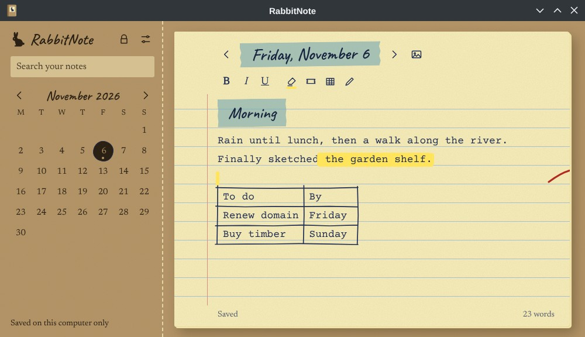

<p align="center"></p>

# RabbitNote

A private notebook for Linux. One ruled paper page per day, with a calendar, #tags and search.

**[Website](https://rabbitmcs.github.io/rabbitnote/)** · **[Download for Ubuntu/Kubuntu (.deb)](https://itsrabbit.com/downloads/rabbitnote_1.3.0_amd64.deb)** · **[Download for other Linux (AppImage)](https://itsrabbit.com/downloads/RabbitNote-1.3.0.AppImage)**



## Features

- Notes and images encrypted on your computer with AES-256-GCM. The key comes from your passphrase (scrypt), which is never stored.
- Optional sync between computers through your own Google Drive. Only encrypted files are uploaded, and the app can only see files it created.
- Bold, italic, underline, highlighter, tape titles, hand-drawn tables, images and free drawing.
- Any Google font, and every color can be changed.
- Encrypted backup files you can restore with your passphrase.

If you forget your passphrase, your notes can't be recovered.

## Build from source

```
cp src/main/google-client.example.js src/main/google-client.js   # add your own Google Desktop app client
npm install
npm start        # run it
npm test         # run the tests
npm run dist     # build .deb and AppImage into dist/
```

The `docs` folder is the website.

Made by [Rabbit](https://github.com/rabbitmcs).
